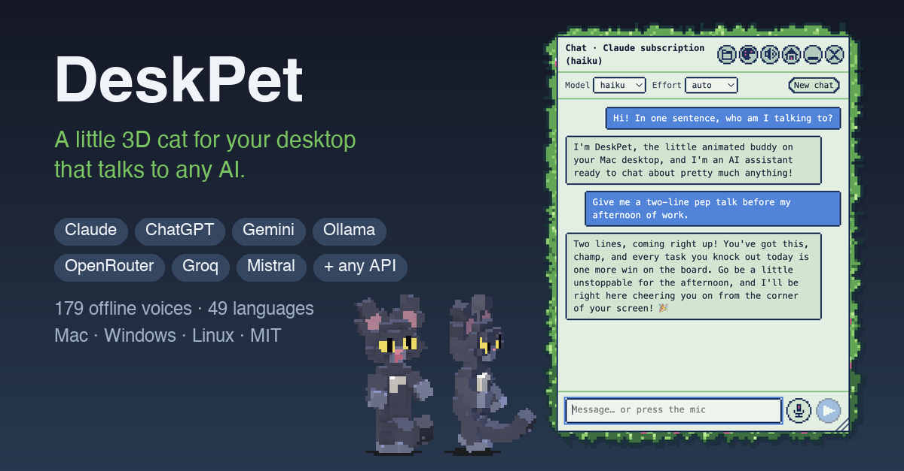
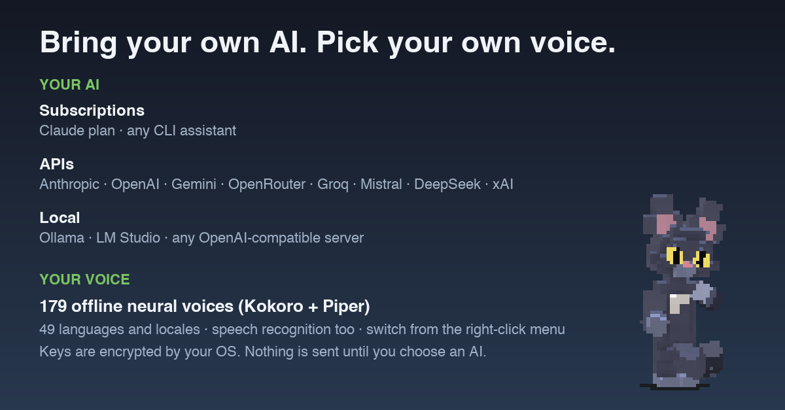
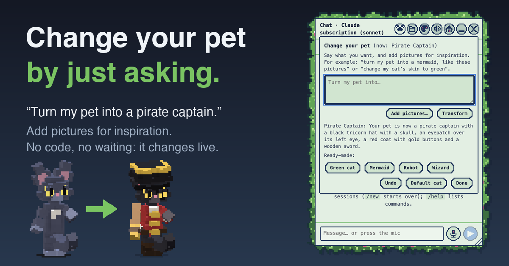

# DeskPet



> **Beta, not a finished product.** DeskPet is an early, actively changing project. It works well on macOS, where it has been tested and used; the Windows and Linux support is
> new and has not yet been run on real machines. Expect rough edges, changing settings, and the occasional bug, and please [report what you find](../../issues).

A small 3D voxel cat that lives on your desktop, walks around, naps, eats the occasional fish, and is a **face for any AI**.
Click it to chat, or talk out loud and hear it answer in an offline neural voice. Tell it **"turn my pet into a mermaid"** (with pictures
if you like) and it redesigns itself on the spot.

* **Bring your own AI:** Claude, ChatGPT/OpenAI, Gemini, OpenRouter, Groq, Mistral, DeepSeek, xAI, local models (Ollama, LM Studio), any OpenAI-compatible
  server, or a command-line assistant you are already signed in to (your subscription, no API key).
* **Change your pet by asking:** describe a new look, add inspiration pictures, and the AI redesigns the voxel pet live. No code. Ready-made pets included.
* **Voices and speech, offline:** 179 neural voices (Kokoro, Piper) in 49 languages and offline speech recognition, downloaded on demand; or the system's own voice.
* **macOS, Windows and Linux** (see [what works where](#what-works-where)).
* **Private by default:** with nothing configured it is an offline demo. API keys are encrypted by your OS. Screen sharing is off until you ask, per message.
* **Source only:** you build and run it yourself. Nothing is downloaded or sent anywhere except what you set up below.



Requirements: Node ≥ 22.12 and, for offline voices and speech, Python ≥ 3.9. On a Mac also the Xcode command-line tools (`xcode-select --install`) for
the optional native helpers. On Linux, a desktop session with a compositor (for the transparent window) and a keyring (gnome-keyring or KWallet) to store API keys.

## Quick start

```bash
git clone <this repository> deskpet && cd deskpet
npm install        # if Electron's binary did not download: node node_modules/electron/install.js
npm run setup      # pick your AI, store its key securely, optionally download voices and speech recognition
npm start          # on a Mac you can also build a real app: npm run app
```

Click the pet to open the chat. Right-click it (or use the tray / menu-bar icon) for the menu. On a Mac, opening the app turns the pet fully on and quitting
(🏠 in the chat, Cmd+Q, menu → Quit) turns it fully off; if you move the project folder, run `npm run app` again.

## Change your pet



Press the **🐾 paw** in the chat header (or choose *Change your pet…* in the menu). Type what you want and, if you like, add up to four pictures (the button, drag and drop,
or paste), then press **Transform**:

* "turn my pet into a mermaid, based on these pictures"
* "change my cat's skin to green"
* "give it a wizard hat and a long blue robe", "make it a robot", "a bit smaller, please"

You can also just say it in the chat (`turn my pet into a pirate captain`, or `/pet …`). The pet changes live; **Undo** goes back (10 steps), **Default cat** resets, and the
ready-made pets (Mermaid, Robot, Wizard, Green cat) work with no AI at all. Without an AI, a plain recolour ("make my cat purple") still works.

How it works: a pet's look is a small piece of data (a *pet spec*: colours, extra or replaced voxel shapes per body part, parts to hide, a size). The connected AI
writes that JSON from your words and pictures, DeskPet validates it strictly (known parts only, hex colours only, size limits; the AI is told what is wrong and tries again),
and only a valid spec is drawn. It is saved in `pet.json` in the data folder and survives restarts. Pictures need a vision-capable model (not the `command` provider and not DeepSeek's text-only model); they are scaled down, sent for that one request, and never stored. Designs take 5 to 90 seconds depending on the model; bigger models draw better. Edit
`assets/pets/*.json` to see the format, or write your own and drop it in that folder.

## Connecting an AI

`npm run setup` does everything below for you. By hand, edit `settings.json` in the data folder (see [Where things are](#where-things-are)):

| `ai.provider` | What it is | Key |
|---|---|---|
| `claude-cli` | Your Claude plan, through the `claude` command (Claude Code) | none: sign in with `claude auth login` |
| `command` | Any command-line assistant (Gemini CLI, Codex, `ollama run`, your own script) | none: it signs in itself |
| `anthropic` | Anthropic API (Claude models) | `ANTHROPIC_API_KEY` |
| `openai` | OpenAI API (ChatGPT models) | `OPENAI_API_KEY` |
| `gemini` | Google Gemini API (free tier available) | `GEMINI_API_KEY` |
| `openrouter` `groq` `mistral` `deepseek` `xai` | Hosted OpenAI-compatible services | `OPENROUTER_API_KEY` … |
| `ollama` `lmstudio` | Models running on this computer | none |
| `custom` | Any OpenAI-compatible server: set `ai.baseUrl` | optional, `ai.apiKeyEnv` |
| `mock` | Offline demo (default) | none |

```json
{ "ai": { "provider": "openai", "model": "gpt-4o" } }
{ "ai": { "provider": "command", "command": "gemini", "args": ["-p", "{prompt}"] } }
{ "ai": { "provider": "custom", "baseUrl": "http://localhost:8080/v1", "model": "my-model" } }
```

* **API keys** are encrypted by your operating system's secure storage (macOS Keychain, Windows DPAPI, the Linux keyring) and kept as ciphertext in `keys.json`.
  `npm run setup` asks for the key with hidden input and passes it to the app on stdin, so it never appears in a command line, a log or `settings.json`.
  Otherwise the key is read from the environment variable named above (`ai.apiKeyEnv` renames it). A key is only ever sent to the service's own address over HTTPS
  (plain `http://` is accepted only for a server on this computer). On macOS the first time a *different build* of the app reads a key, the system may ask once to allow it.
* **Models:** the panel's Model dropdown lists suggestions plus whatever the service reports; `/model <any name>` or saying "switch to gpt-4o" uses any model the service accepts.
  `ai.models` adds your own names. The choice is remembered per service.
* **`command` provider:** the system prompt and conversation go to the program's stdin and its stdout is the reply. If an argument contains `{prompt}` the prompt goes there
  instead; `{model}` is replaced by the model name. No shell is involved. The program runs with your normal environment in an empty folder, and DeskPet cannot control what tools
  *that* program has, so choose one you trust. It cannot look at pictures. The third-party examples here are illustrations: check that program's own documentation for its flags.
* **`claude-cli` provider:** runs your own unmodified `claude` command once per message with no tools, no connectors, no saved session and a scrubbed environment, and refuses an
  API-key login unless `ai.allowBilledApi` is true. DeskPet never sees your Claude login. `/effort low|…|max` works only here.
* **Personality:** `ai.persona` is `playful` (default, a cheeky layer on top of the model) or `plain`. The pet is a face: it never replaces the model's knowledge or honesty.

## Memory and conversation

* The conversation is saved to `history.json` in the data folder (never any screenshot), up to 600 messages. When it gets long, the older part is folded into a short summary by the same
  service (visible and deletable in 🗂). `memory.summarize: false` turns that off; `/new` starts over.
* **Memory** is a folder of plain Markdown files (default `<data folder>/memory`; change with `memory.dir`) read into every request. Say "remember that…" and the model can save a
  note there; each save is announced. No memory is written while a screenshot is attached (text on a screen could be trying to plant one). `memory.enabled` / `memory.write`
  switch reading / writing off. Open 🗂 to read or delete anything it keeps.
* The offline demo keeps nothing on disk.

## Voices and talking

Output: **local** (offline neural voices, nothing leaves your computer) or **system** (macOS `say`, Windows SAPI, Linux espeak-ng / speech-dispatcher).
Input: offline **speech recognition** (any OS), or Apple's on-device recogniser on a Mac.

```bash
npm run voices -- setup                       # one-time: a private Python environment with sherpa-onnx (pinned to the version these models need)
npm run voices -- list                        # all 179 voices: ✓ installed, ★ recommended
npm run voices -- install --recommended       # ~2 GB: 73 voices across 39 languages and locales
npm run voices -- install piper-en_GB-alba-medium kokoro-int8-en-v0_19
npm run voices -- install --lang de           # every German voice
npm run voices -- try piper-en_US-amy-medium "Hello there"    # audition one
npm run speech -- list                        # offline speech recognition models (English, French, Spanish, German, Chinese, Korean, Russian)
npm run speech -- install stt-en              # ~310 MB, accurate English; or --recommended
```

Voices and models come from the [sherpa-onnx](https://github.com/k2-fsa/sherpa-onnx/releases) releases (Kokoro: Apache-2.0; Piper voices each carry their own licence in their
folder's `MODEL_CARD`) and live in the data folder, never in the repository. Kokoro has 53 named speakers in 9 languages; most Piper voices are one speaker.

**Switch voice any time:** right-click the pet → **Voice**: a local voice by language (Kokoro lists its speakers) or a system voice. The choice is remembered and the new voice says hello.
In `settings.json`: `voice.engine` (`local` or `say` = the system voice), `voice.local.model`, `voice.local.sid` (speaker), `voice.local.pitch` (1 = natural; 1.1–1.2 sounds younger) and
`voice.local.speed`. With no local voice installed it uses the system voice automatically.

**Talking to it:** 🎤 starts a live conversation (it sends when you pause, listens again after it replies; ✋ interrupts). `speech.engine` is `auto` (a Mac uses Apple's recogniser when
built, everything else the offline models), `apple` or `local`; `speech.model` picks an installed model. Recognition never uses a server, except Apple's if you set
`voice.allowServerRecognition`. The microphone is open only while listening, in a separate process that exits when you stop.

## Using it

| Action | How |
|---|---|
| Open / close chat | click the pet, tray / menu-bar icon → Chat…, or **Ctrl/Cmd+Alt+Shift+C** |
| Talk | 🎤 button or **Ctrl/Cmd+Alt+Shift+V** (Esc discards) |
| Change your pet | 🐾 button, the menu, or say "turn my pet into…" |
| Stop a reply or the voice | Stop button or Esc |
| Mute spoken replies | 🔊 button or menu |
| Share your screen (one message) | 📷 then type, `/screen <question>`, saying "look at my screen", or **Ctrl/Cmd+Alt+Shift+S** |
| Model / effort | dropdowns, `/model <name>`, `/effort <level>` (Claude subscription only), or "switch to <model>" |
| Fresh conversation | **New chat** or `/new` |
| What it knows | 🗂 (memory, conversation, summary) |
| Look of the panel | 🎨 (colour, richness, brightness, opacity, presets) |
| Move the pet | drag it anywhere; it stays where you drop it |
| Hide / show | menu or **Ctrl/Cmd+Alt+Shift+P** |

Menu options: *Voice*, *Rest at home*, pause walking, and (macOS) *Bring the cat with me* and *Where he walks*. Fish appear on a bare desktop every so often and the pet goes to eat them.

## What works where

| | macOS | Windows | Linux |
|---|---|---|---|
| Pet, chat, every AI provider, memory, pet designer | ✅ tested | ⚠️ not yet run on a real machine | ⚠️ not yet run on a real machine |
| Offline voices and speech recognition | ✅ tested | ⚠️ written to be portable, untested | ⚠️ written to be portable, untested |
| System voice | `say` | PowerShell + SAPI | espeak-ng or speech-dispatcher (install one) |
| Apple on-device speech recognition | ✅ | – | – |
| API key storage | Keychain | DPAPI | needs a keyring (gnome-keyring / KWallet) |
| Pet sits on the desktop *behind* windows, walks around window edges and desktop icons | ✅ | – (always-on-top overlay, walks the screen) | – (same) |
| Screen sharing with the exclusion list (password managers blocked) | ✅ | opt-in: `screen.allowUnchecked` | opt-in: `screen.allowUnchecked` |
| Watching rules | ✅ | – | – |
| Build an app | `npm run app` | `npm start` | `npm start` |
| `claude-cli` provider | ✅ | ⚠️ the `claude` command may be a `.cmd` shim, which cannot be started without a shell: use an API provider | ✅ expected |

Everything outside macOS was written to be portable (the unit tests run on all three systems in CI), but I could only run the app itself on a Mac. If you try it on Windows or
Linux, please open an issue with what you find. Wayland (Linux) may place or click-through the transparent window differently from X11.

## Privacy and safety

* **Nothing is sent anywhere until you choose an AI.** What then leaves your computer: your messages, the recent conversation (or its summary), your memory notes, inspiration pictures you add
  for a pet design, and a screenshot only when you ask, to the service you picked. Offline voices and speech recognition never send audio anywhere.
* **Screen sharing** is per message and in memory only: one image of the display the pet is on, scaled down, never written to disk. Apps in `screen.excludeApps` (password managers by
  default) block the capture if any of their windows is visible (macOS). `screen.enabled: false` removes the feature entirely. Text inside a screenshot is treated as data, never instructions.
* **Pet designs** cannot run anything: the AI's reply is parsed as plain data against a strict schema and rejected otherwise. Pictures are scaled down, used for that request, and not kept.
* **Watching** (rule-based nudges when a chosen app comes to the front, macOS) is off by default and starts off every launch. Rules marked `ask` can send a screenshot by themselves only if you also set `proactive.enabled`.
* **No actions:** the assistant behind the pet has no tools: it cannot read your files, run commands or click anything (with the `command` provider, see the note above).
* **Hardening:** sandboxed renderers with context isolation and a strict CSP, IPC validated and accepted only from the matching window, no navigation or popups.
  The app opens no network connections of its own except to the AI service you configure.
* Permissions the OS may ask for: microphone (🎤), screen recording (screen sharing, macOS), Automation → Finder (macOS, so the pet can walk around desktop icons; refusing is fine).

## Where things are

Settings, history, memory, the pet's look, encrypted keys and downloaded models live in one data folder (set `DESKPET_DATA_DIR` to move it):

| macOS | Windows | Linux |
|---|---|---|
| `~/Library/Application Support/DeskPet` | `%APPDATA%\DeskPet` | `~/.config/DeskPet` |

`settings.json` is created on first run and never rewritten by the app (menu and panel choices go to `prefs.json`, `theme.json` and `pet.json` next to it). Missing keys use the defaults; invalid values
fall back with a warning on stderr; an unparsable file is left untouched.

```jsonc
{
  "shortcuts": { "toggleHide": "CommandOrControl+Alt+Shift+P", "toggleChat": "CommandOrControl+Alt+Shift+C", "toggleListen": "CommandOrControl+Alt+Shift+V",
                 "lookAtScreen": "CommandOrControl+Alt+Shift+S", "toggleWatch": "CommandOrControl+Alt+Shift+W" },
  "sleepAfterMs": 300000,
  "voice": { "speakReplies": true, "engine": "local", "local": { "model": "kokoro-multi-lang-v1_0", "sid": 3, "pitch": 1, "speed": 1, "python": "", "modelsDir": "" },
             "voice": "", "rate": 185, "live": true, "locale": "en-US", "allowServerRecognition": false, "autoSend": false,
             "maxSpokenChars": 600, "maxListenSeconds": 30, "silenceMs": 1200 },
  "speech": { "engine": "auto", "model": "" },
  "ai": { "provider": "mock", "model": "", "models": [], "baseUrl": "", "apiKeyEnv": "", "command": "", "args": [], "timeoutSeconds": 120, "allowBilledApi": false, "persona": "playful" },
  "memory": { "enabled": true, "write": true, "dir": "", "summarize": true },
  "screen": { "enabled": true, "display": "pet", "maxEdge": 1568, "excludeApps": ["1Password", "Bitwarden", "…"], "allowUnchecked": false },
  "observe": { "enabled": false, "intervalSeconds": 20, "maxPerHour": 6, "rules": [] },
  "proactive": { "enabled": false },
  "cat": { "view": "figure", "coat": "black", "pixelSize": 2, "bringWithMe": false, "restAtHome": false, "roam": "edges" }
}
```

`voice.voice` / `voice.rate` apply to the system voice. A watch rule looks like `{ "app": "Mail", "action": "nudge", "minChange": 0, "cooldownMinutes": 10, "prompt": "Summarise this email." }`.
Custom pets need `cat.view: "figure"` (the default).

## Development

```bash
npm test                 # unit tests (vitest); the speech test also needs `npm run speech -- install stt-en` and is skipped without it
npm run typecheck
npm run e2e:claude       # real app against a fake assistant command: streaming, history, stop, errors, quit (~25 s)
npm run e2e:conversation # models, memory, markdown, restart, screenshots, watching (~50 s)
npm run e2e:pet          # the "change your pet" drawer: presets, undo, an AI design from text + a picture, offline recolour, persistence (~15 s)
npm run e2e              # the full UI suite with a fake microphone and voice: window, chat, voice, sleep, drag, GPU loss (~100 s)
npm run e2e:roam         # where the pet lives and walks: desktop layer, diagonal walking, drop anywhere, panel move/resize/minimise (~105 s)
```

The e2e suites launch the real app briefly (it takes focus, so run them one at a time and don't type meanwhile; they are written for macOS). They use fake assistants and make no network calls. `PET_DEBUG=1 npm start` prints state changes as JSON lines. Test-only switches (`PET_E2E`,
`PET_USER_DATA`, `PET_SAY_BIN`, …) are read only when `PET_E2E=1`. CI (`.github/workflows/ci.yml`) runs the typecheck and unit tests on macOS, Linux and Windows.

```
src/main/        Electron lifecycle, pet and chat windows, behaviour clock, menus, fish, the headless key tool
src/renderer/    pet (3D voxel figure or sprite) and chat panel (with the pet-change drawer)
src/shared/      pure logic: state machine, perimeter walking, voxel models, pet spec, IPC validators, commands
src/services/ai/       ChatProvider interface; Claude CLI, command, HTTP (OpenAI-compatible + Anthropic) and mock providers; providers.json; key store; pet designer
src/services/memory/   settings, history, summaries, prefs, memory files, pet store
src/services/voice/    speech-to-text (helper process), text-to-speech (local sherpa-onnx, system), switchable engine, voice catalog
src/services/screen/   capture, exclusions, window source, opt-in watching
native/          macOS helpers (Swift speech + windows, window-level addon); tts/ and stt/: the Python sherpa-onnx servers (all systems)
assets/          sprites, icon, ready-made pets (pets/), voices/catalog.json, speech/catalog.json
tools/           setup, voices, speech, app builder (macOS), e2e suites and test doubles
```

To add another AI service that speaks the OpenAI chat protocol, add an entry to `src/services/ai/providers.json`; nothing else is needed.

## Troubleshooting

* `Error: Electron uninstall`: run `node node_modules/electron/install.js`.
* The assistant doesn't answer: the red message in the panel says what to do (missing key → `npm run setup`; not signed in → `claude auth login`). `npm run setup -- --show` prints what is configured.
* "Change your pet" says it cannot see pictures: the connected AI or provider has no vision (use an API provider with an image-capable model).
* No sound or no voices in the menu: `npm run voices -- setup`, then `npm run voices -- install --recommended`. On Linux the system voice needs `espeak-ng` (`sudo apt install espeak-ng`).
* Talking does nothing: `npm run speech -- install stt-en` (or `--recommended`); on a Mac `npm run helper` builds Apple's recogniser. Allow microphone access for DeskPet when asked.
* Linux: "no secure storage": install a keyring (`gnome-keyring` or KWallet) or use an environment variable for the key (`ai.apiKeyEnv`).
* No menu-bar / tray icon (notched MacBooks, some Linux desktops): right-click the pet, or use the shortcuts.

## License

MIT, see [LICENSE](LICENSE). Voice and speech models and the Electron/three.js dependencies have their own licences.
